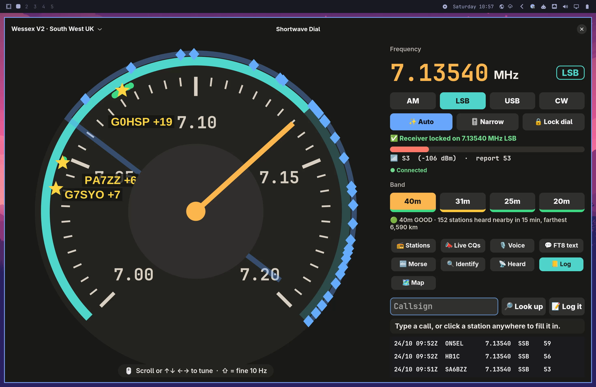

# 📻 Shortwave Dial

A retro tuning dial for your desktop. It tunes one public
[KiwiSDR](http://kiwisdr.com/) web receiver, so you can listen to shortwave
without a radio.

Made by Jonathan, **G7MJF**, for [Omarchy](https://omarchy.org) (Arch Linux + Hyprland).



## What it does

- **Tune by scrolling** the big dial, or with the arrow keys (Shift = 10 Hz steps).
- **Bands and modes**: 40m, 31m, 25m, 20m · AM, LSB, USB, CW.
- **FT8 decoder**, written from scratch in Python + numpy.
  The stations it hears show up as stars on the dial.
- **Map tab**: every FT8 station heard, on a world or Europe map.
- **Morse (CW) decoder**, S-meter, band conditions.
- **Callsign lookup** and a simple log (ADIF).
- **Waybar pill** that shows the frequency, e.g. `📻 7.074 USB`.

## How it works

```
Dial window / swdial CLI / Waybar ──rigctl on TCP 6400──▶ kiwiclientd ──▶ KiwiSDR
```

The window starts [kiwiclient](https://github.com/jks-prv/kiwiclient)'s
`kiwiclientd`, which plays the receiver's audio through PipeWire. The dial
then tunes it with plain hamlib rigctl commands (`F <Hz>`, `M <mode>`).

## Install

You need Python 3, GTK4 and PyGObject (Omarchy has these).

```sh
git clone https://github.com/funcoder/shortwave-dial
cd shortwave-dial
python -m venv --system-site-packages .venv
.venv/bin/pip install numpy soundcard pytest
git clone --depth 1 https://github.com/jks-prv/kiwiclient vendor/kiwiclient
```

## Run

```sh
.venv/bin/python -m swdial.gtk_app        # the dial window
.venv/bin/python -m swdial.desktop        # add it to the app launcher (Super + Space)
```

From the command line, while the window is open:

```sh
.venv/bin/python -m swdial.cli band 40m
.venv/bin/python -m swdial.cli tune 7074000 usb
.venv/bin/python -m swdial.cli step +500
```

### Waybar

```jsonc
"custom/swdial": {
  "exec": "~/shortwave-dial/.venv/bin/python -m swdial.cli waybar",
  "return-type": "json", "interval": 2,
  "on-scroll-up": "~/shortwave-dial/.venv/bin/python -m swdial.cli step 100",
  "on-scroll-down": "~/shortwave-dial/.venv/bin/python -m swdial.cli step -100"
}
```

### Callsign lookup (optional)

Lookups work without an account. For QRZ or HamQTH details, put your login in
`~/.config/shortwave-dial/accounts.ini`:

```ini
[qrz]
user = YOURCALL
password = ...
```

## Decode an FT8 recording

```sh
.venv/bin/python -m swdial.ft8 clip.wav --base-hz 7074000 --auto-offset
```

## Tests

```sh
.venv/bin/python -m pytest -q tests
```

## Be kind to public receivers

KiwiSDRs are run by volunteers. Use one channel, keep sessions short, don't
scan, and disconnect when you're done. Only use receivers whose owner allows
non-browser connections.

## Credits

- [kiwiclient](https://github.com/jks-prv/kiwiclient) by jks-prv. It runs as a
  separate program and is not included here.
- Coastlines: [Natural Earth](https://www.naturalearthdata.com/) 110 m (public domain).
- FT8 written from the public protocol description (QEX, 2020).

## Licence

MIT, see [LICENSE](LICENSE). This covers the code in this repo only, not kiwiclient.

73 de G7MJF
